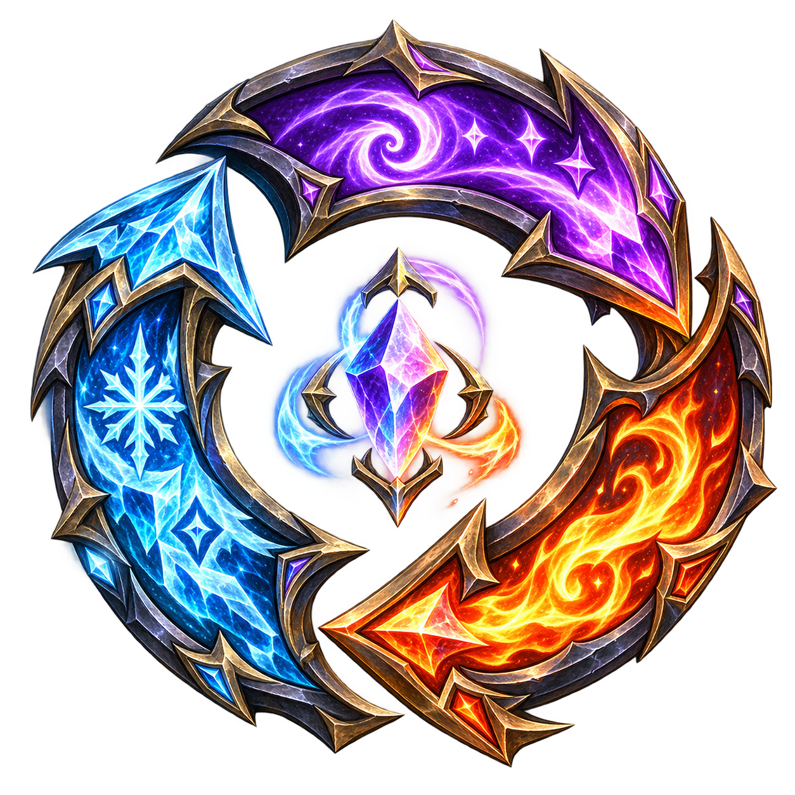

# Rotation Master

[![Buy Me Coffee][coffee-image]][coffee]

[![Tests][tests-badge]][tests]
[![GitHub Release][release-badge]][releases]
[![GitHub Activity][activity-badge]][commits]
[![License: MIT + Attribution][license-badge]][license]

[![Retail 12.1.5][retail-badge]][client-support] [![Forever 1.60.1][forever-badge]][client-support]
[![Classic Era 1.15.9][era-badge]][client-support] [![Season of Discovery 1.15.9][sod-badge]][client-support]
[![TBC Anniversary 2.5.6][tbc-badge]][client-support] [![Mists Classic 5.5.4][mists-badge]][client-support]

Rotation Master is a World of Warcraft addon that highlights the next spell or item in a rotation you choose. Start with a
Built In rotation for your class, or create your own in game. You press the buttons: the addon does not cast spells or play
for you.

<p align="center">
  
</p>

Version 2.0 is a rewrite of the 1.x addon and is being prepared as a beta. See the [beta guide](docs/release/BETA.md) for
installation, testing and known issues.

## What it does

- **Build rotations in game.** Put spells and items in priority order, add conditions, and use Branch and Stop steps to
  handle different situations. Start with a Built In rotation and adjust it for your character.
- **Choose when to use them.** Keep several rotations and select one manually or let Rotation Master switch when a
  rotation's conditions match.
- **Highlight your actions.** Light matching buttons on supported action bars, show cooldowns alongside your main
  rotation, and optionally display a movable recommendation preview.
- **Understand and share your rules.** Combine conditions with AND, OR and Unless, inspect their current match state,
  compare rotations, and import or export Rotation Master data. Advanced users can also write custom Lua conditions.
- **Configure extras.** Create item sets, announcements, highlight effects and profiles, with optional integrations for
  other addons.

Built In rotations are starting points, not guarantees of the best action for every character, encounter or play style.

## Supported WoW clients

| Client | Interface |
| --- | --- |
| Classic Era / Season of Discovery 1.15.9 | 11509 |
| TBC Anniversary 2.5.6 | 20506 |
| Mists of Pandaria Classic 5.5.4 | 50504 |
| Retail (Midnight) 12.1.5 | 120105 |
| WoW Forever 1.60.1 | 16001 |

These are the clients targeted by the beta; they have not all been verified in game. See [client support][client-support]
for what has actually been tested. Retail and Forever restrict some game information and addon actions, so available
conditions vary. Raid-marker units, marker conditions and Set Mark are unavailable on those two clients.

Rotation Master uses your game language automatically: English, German, Spanish, Latin American Spanish, French, Italian,
Korean, Brazilian Portuguese, Russian, Simplified Chinese and Traditional Chinese.

## Install and get started

- **[CurseForge](https://www.curseforge.com/wow/addons/rotation-master), [Wago Addons](https://addons.wago.io/addons/rotation-master) or WowUp:** install Rotation Master with your addon manager. Select the beta release channel for beta versions.
- **[WoWInterface](https://www.wowinterface.com/downloads/info25079-RotationMaster.html):** stable releases only.
- **Manual install:** download a release zip and extract all of its folders into the client's `Interface/AddOns` directory.
  The package includes the main addon, class modules and language modules.

In game, type `/rm config`, open **Rotations**, and choose a Built In rotation or create one. Place the relevant spells and
items on a supported action bar. `/rm help` lists the commands; `/rm debug glow` explains why a recommendation is or is not
lighting a button, and `/rm errors` opens the addon error report.

[Documentation and rotation sharing](https://rotationmaster.neuromancy.net/) · [Report an issue](https://github.com/corporategoth/rotationmaster/issues) · [Discord](https://discord.gg/4aKZSpUMet)

## Developer information

| For | Start at |
| --- | --- |
| Testers | [Beta guide](docs/release/BETA.md) |
| Contributors | [CONTRIBUTING.md](CONTRIBUTING.md) and [developer docs](docs/dev/architecture.md) |
| Translators | [Translator guide](docs/translators/README.md) |
| Maintainers | [Release guide](docs/release/RELEASING.md) |
| Topic references | [Architecture](docs/architecture/), [quality](docs/quality/) and [Built In modules](Modules/README.md) |

Requirements for the offline checks are Python 3, Lua 5.1 and LuaJIT:

```sh
python3 tools/setup_lint.py
python3 tools/check --static
python3 tools/check_all.py --baseline tools/known_failures.txt
python3 tools/package_release.py --check
```

See [running the checks](docs/dev/running-things.md) for details. The project's Gitea repository is the source of truth;
GitHub is a mirror.

## License

Rotation Master is released under [MIT + Attribution](LICENSE), copyright 2018–2026 Preston A. Elder. Derivatives must
acknowledge Rotation Master and its original author, PreZ, in any credits or About pages, including in game. Versions through
1.4.3e remain plain MIT. Vendored libraries and the font retain their own licenses; see `Libs/UPSTREAM.json`,
`Libs/Ace3-LICENSE.txt` and `Fonts/OFL.txt`. Third-party notices are in `THIRD_PARTY_NOTICES.md`.

[coffee-image]: https://cdn.buymeacoffee.com/buttons/default-orange.png
[coffee]: https://buymeacoffee.com/corporategoth
[tests-badge]: https://img.shields.io/github/actions/workflow/status/corporategoth/rotationmaster/checks.yml?branch=master&label=tests&style=for-the-badge
[tests]: https://github.com/corporategoth/rotationmaster/actions/workflows/checks.yml
[release-badge]: https://img.shields.io/github/v/release/corporategoth/rotationmaster?style=for-the-badge
[releases]: https://github.com/corporategoth/rotationmaster/releases
[activity-badge]: https://img.shields.io/github/commit-activity/y/corporategoth/rotationmaster?style=for-the-badge
[commits]: https://github.com/corporategoth/rotationmaster/commits/master
[license-badge]: https://img.shields.io/badge/license-MIT%20%2B%20Attribution-blue?style=for-the-badge
[license]: LICENSE
[retail-badge]: https://img.shields.io/badge/Retail-12.1.5-blue?style=for-the-badge
[forever-badge]: https://img.shields.io/badge/Forever-1.60.1-blue?style=for-the-badge
[era-badge]: https://img.shields.io/badge/Classic%20Era-1.15.9-orange?style=for-the-badge
[sod-badge]: https://img.shields.io/badge/Season%20of%20Discovery-1.15.9-orange?style=for-the-badge
[tbc-badge]: https://img.shields.io/badge/TBC%20Anniversary-2.5.6-orange?style=for-the-badge
[mists-badge]: https://img.shields.io/badge/Mists%20Classic-5.5.4-orange?style=for-the-badge
[client-support]: docs/quality/client-support.md
